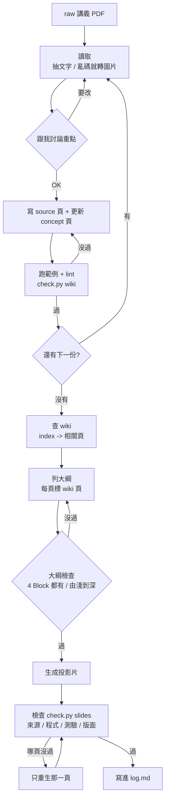

# loop / graph 設計

## 整體流程

## 會重複的地方
- ingest loop：一份資料跑一圈，7 份跑 7 圈
- 討論 loop：重點我不同意就回去重讀
- wiki 檢查 loop：範例跑不對、斷連結 -> 回去改頁面
- 大綱 loop：缺 Block、順序亂 -> 重列
- 簡報檢查 loop：哪頁錯只重生那頁，不整份重來

## 要檢查 / 重生的地方
- 讀取：抽文字壞掉 (亂碼、順序亂) -> 改看圖
- wiki：每段範例真的跑、連結、有沒有標來源、有沒有進 index、講義沒有的要標補充
- 簡報
  - data-src 指的 wiki 頁存在
  - 範例輸出、測驗答案用 python 實際跑來對
  - 內容在 data-src 那頁找得到
  - 版面沒超出

## 為什麼這樣設計
- 先討論後生成：AI 抽 PDF 會看錯，人先看重點比事後找錯快
- 簡報只能查 wiki 不直接讀 raw：wiki 已經檢查過，簡報錯了也知道回哪一頁改
- 每頁標 data-src：wiki 和簡報可以對回去，也讓 checker 自動查
- 只重生錯的那頁：整份重生會把對的頁也改掉，又要重查

## 實際跑一次的結果
完整紀錄在 [wiki/log.md](wiki/log.md)

- wiki 第 1 輪：17 段範例全對，只有 log.md 還沒建
- slides 第 1 輪：顯示通過但只查到 1 段 -> checker 自己有 bug
- slides 第 2 輪：slide 11 輸出多一個空白、slide 9 有 wiki 沒寫的話
- slides 第 3 輪：截圖發現 slide 4、13 超出頁面
- slides 第 4 輪：加版面檢查，先用舊版測過抓得到
- 最終：wiki 23 頁、17 段範例；slides 24 頁、20 段範例、4 題測驗，全過

## 反思

1. 最常出錯的節點
- 「生成投影片」：4 個錯 (多空白、沒來源的句子、2 頁版面超出)
- 其次是「讀取」：tips 亂碼、lesson2 程式順序亂
- 意外的是 checker 自己也錯 2 次 (regex 漏抓、字型沒載完)，而且錯的時候是顯示「通過」，最危險

2. 檢查往前移到哪
- 程式範例：本來簡報可以自己寫範例，在最後才檢查 -> 改成範例只能從 wiki 拿，wiki 在 ingest 時就跑過了
- 內容有沒有亂掰：本來最後對照 -> 移到列大綱，每頁先標 wiki 頁才能生成
- 版面：本來最後截圖用眼睛看 -> 變成 check.py 的一部分，每次生成完自動量

3. 有沒有改 workflow
- 有，CLAUDE.md 加了 3 條
  - 簡報範例只能從 wiki 拿：slide 11 的錯就是自己新寫的範例
  - checker 要印「查了幾段」：第 1 輪 all passed 其實只查 1 段
  - 新的檢查先用壞掉的版本測：版面檢查第一次沒抓到 slide 13
- 原因：錯最多的不是生成本身，而是「以為檢查過了」，所以要先能相信檢查
