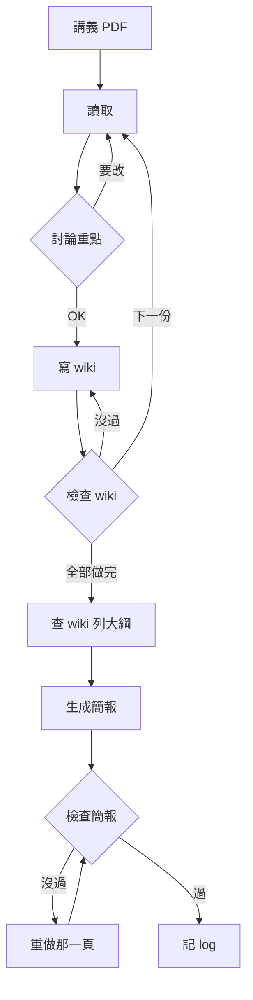

# loop / graph

## 重複 / 檢查
- 一份講義跑一圈，7 份跑 7 圈
- 檢查 wiki：範例實際跑、連結、來源
- 檢查簡報：範例和測驗答案實際跑、來源、版面
- 簡報哪頁沒過只重做那頁

## 為什麼
- 先討論：AI 讀 PDF 會讀錯，先看過再寫比較放心
- 簡報只查 wiki：不然簡報跟 wiki 各寫各的，wiki 就白做了

## 實際跑的結果
見 [log](wiki/log.md)

## 反思
- 錯最多的是生成簡報，但最在意的是檢查程式自己有錯，第一次說全部通過，其實只查了 1 段
- slide 11 錯在簡報自己新寫的範例 -> 範例檢查移到寫 wiki 時，簡報只能用 wiki 裡的
- 版面原本截圖用眼睛看，漏了 2 頁 -> 改成自動檢查
- CLAUDE.md 加規則：檢查要顯示查了幾段、新的檢查先拿弄錯的版本試
