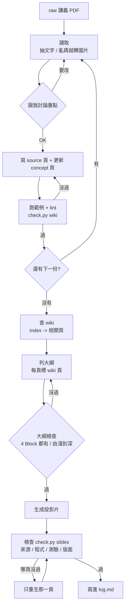

# loop / graph 設計

## 整體流程

## 會重複的地方
- ingest loop：一份資料跑一圈，7 份跑 7 圈
- 討論 loop：重點我不同意就回去重讀
- wiki 檢查 loop：範例跑不對、斷連結 -> 回去改頁面
- 大綱 loop：缺 Block、順序亂 -> 重列
- 簡報檢查 loop：哪頁錯只重生那頁，不整份重來

## 要檢查 / 重生的地方
- 讀取：抽文字壞掉 (亂碼、順序亂) -> 改看圖
- wiki：每段範例真的跑、連結、有沒有標來源、有沒有進 index、講義沒有的要標補充
- 簡報
  - data-src 指的 wiki 頁存在
  - 範例輸出、測驗答案用 python 實際跑來對
  - 內容在 data-src 那頁找得到
  - 版面沒超出

## 為什麼這樣設計
- 先討論：AI 讀 PDF 會讀錯 (像 tips 整份亂碼)，我先看過重點再寫比較放心
- 簡報只查 wiki：不然簡報跟 wiki 會各寫各的，wiki 就白做了
- 每頁標來源：我自己要能對回去，看這頁是從哪來的
- 只重做錯的那頁：整份重做的話，原本對的頁也可能被改掉

## 實際跑一次的結果
完整紀錄在 [wiki/log.md](wiki/log.md)

- wiki 第 1 輪：17 段範例全對，只有 log.md 還沒建
- slides 第 1 輪：顯示通過但只查到 1 段 -> checker 自己有 bug
- slides 第 2 輪：slide 11 輸出多一個空白、slide 9 有 wiki 沒寫的話
- slides 第 3 輪：截圖發現 slide 4、13 超出頁面
- slides 第 4 輪：加版面檢查，先用舊版測過抓得到
- 最終：wiki 23 頁、17 段範例；slides 24 頁、20 段範例、4 題測驗，全過

## 反思

1. 哪個節點最常出錯
- 生成簡報錯最多，4 個 (輸出多空白、wiki 沒寫的句子、2 頁版面跑掉)
- 讀 PDF 也會錯，tips 中文亂碼、lesson2 程式順序亂掉
- 但讓我最在意的是檢查程式自己有錯，第一次跑說全部通過，結果只查了 1 段

2. 檢查往前移到哪
- 範例：原本簡報可以自己寫新範例，最後才檢查。slide 11 就是新寫的範例出錯 -> 改成寫 wiki 時就先跑，簡報只能用 wiki 裡的
- 內容：原本做完簡報才對照 wiki -> 改成列大綱時就要標每頁用哪個 wiki 頁
- 版面：原本最後截圖一頁頁看，2 頁沒看出來 -> 改成生成完自動檢查

3. 有沒有改 workflow
- 有，CLAUDE.md 多加 3 條規則
  - 簡報範例只能從 wiki 拿
  - 檢查結果要顯示查了幾段，數字不對就是漏查
  - 新加的檢查先拿故意弄錯的版本試，確定抓得到
- 因為「通過」不代表真的沒問題，檢查本身也要先確認是對的
